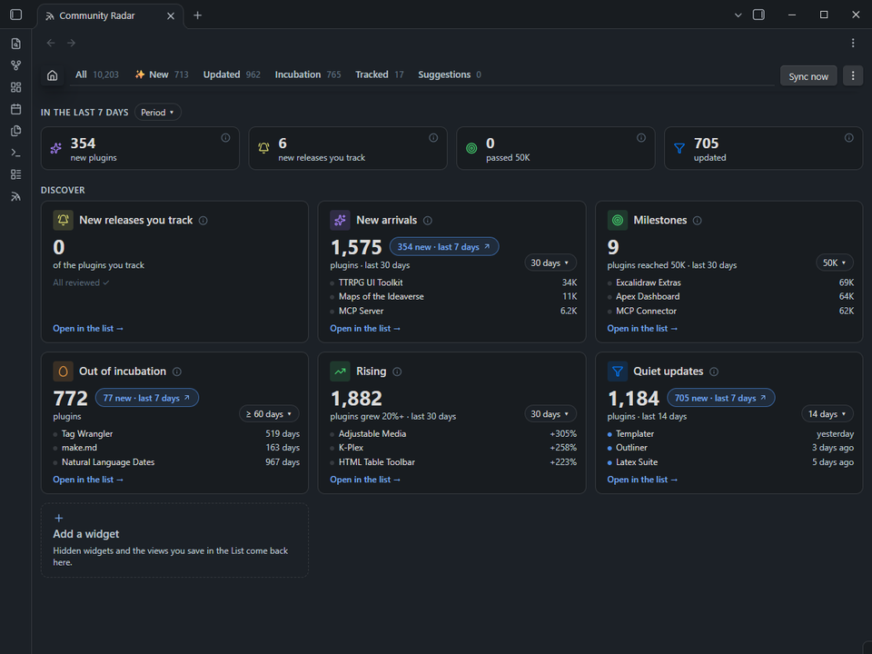
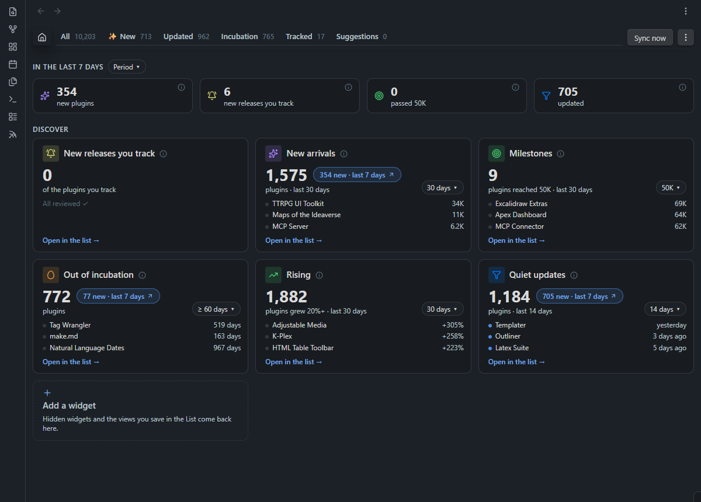
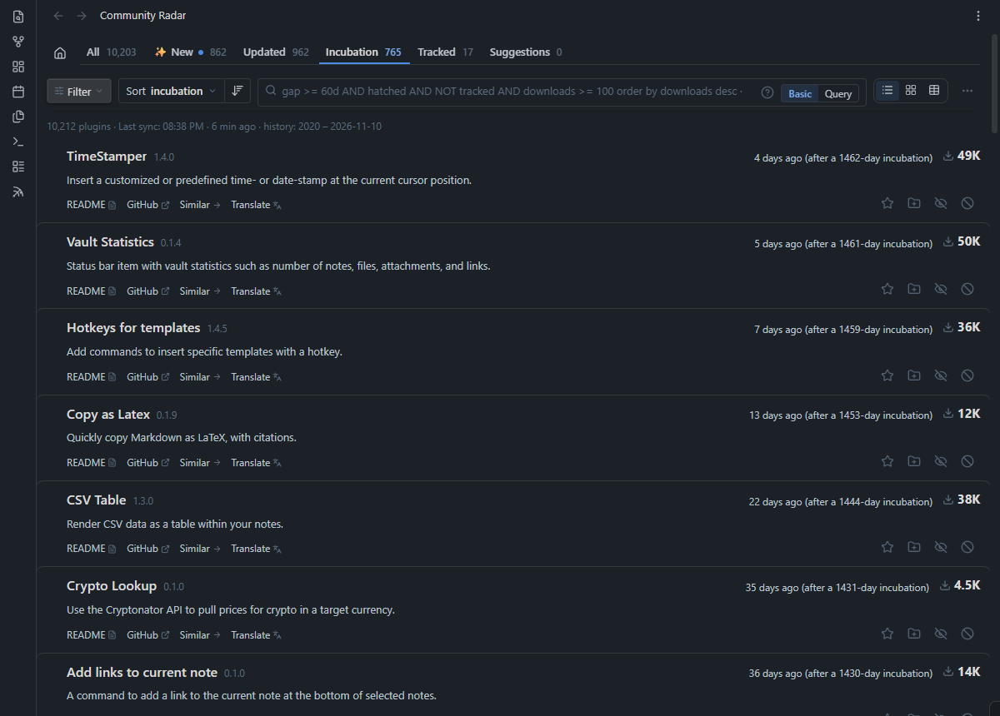
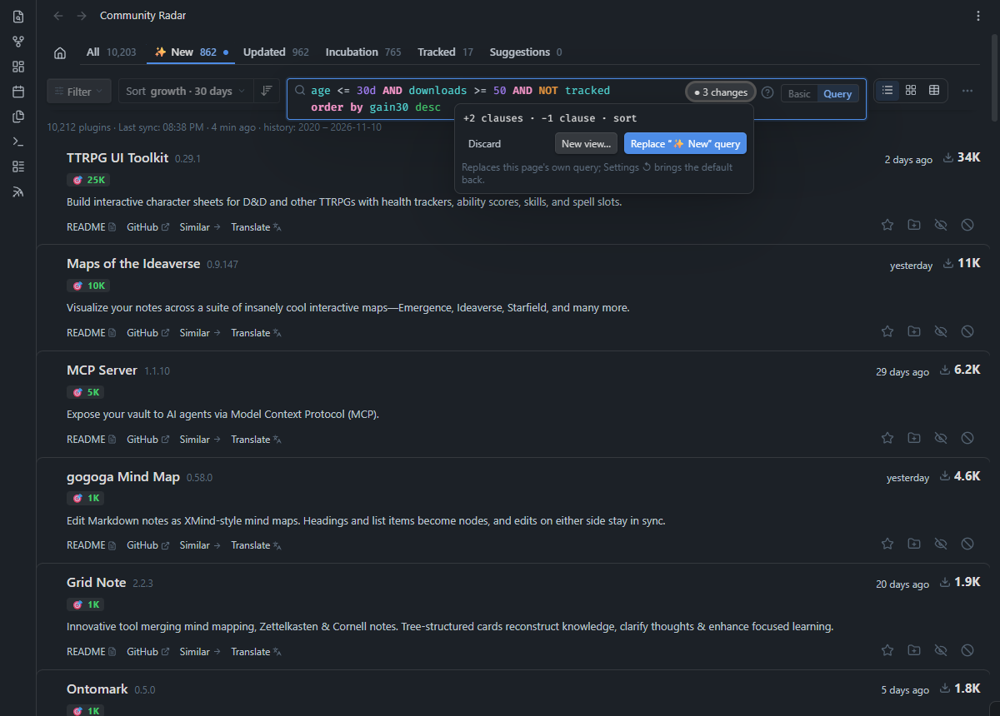
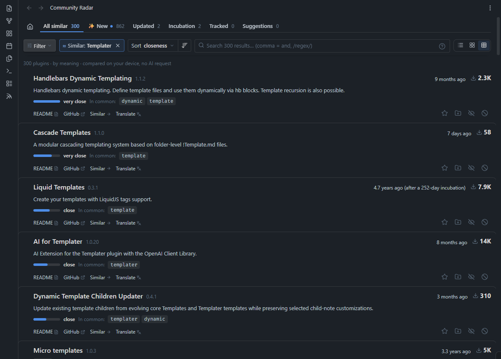
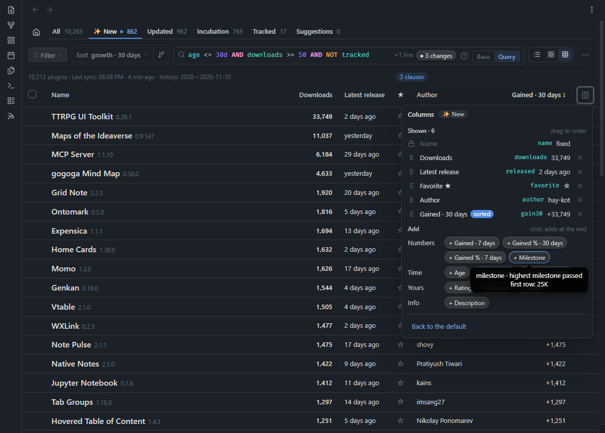
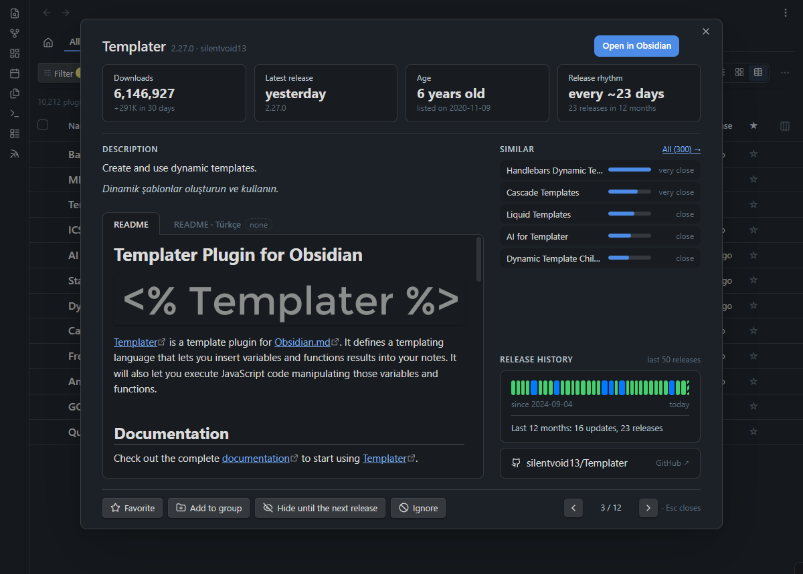
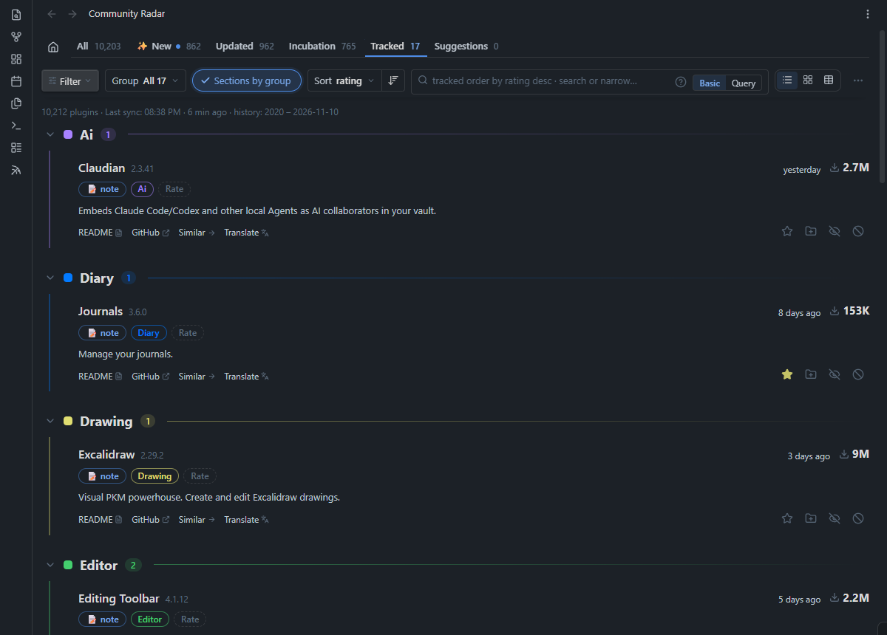

<div align="center">

# Community Radar

**Turn Obsidian's plugin directory into a live discovery engine and personal curation workspace.**

Spot fast-rising newcomers, catch long-dormant plugins making a comeback, query the catalog like a database, discover alternatives by meaning—and keep the plugins you care about as living Markdown notes in your vault.

[](https://obsidian.md)
[](LICENSE)
[](#install)

*English · [Türkçe](README.tr.md)*

</div>



---

## Why Community Radar?

Obsidian's built-in plugin browser is great for installing a plugin when you already know its name—but as the catalog grows into the thousands, genuine discovery hits a wall:

- **All-time downloads hide today's momentum.** A five-year-old giant always sits at the top, while a brilliant month-old plugin gaining a thousand users this week stays buried. Community Radar replays **every daily release snapshot since October 2020** to surface real 7- and 30-day growth, fresh milestones, and release rhythms.
- **Frequent patchers drown out real comebacks.** Plugins shipping tiny tweaks every few days push everything else off the screen. By grouping rapid patches into *update waves*, Community Radar filters out release noise and spotlights quiet plugins waking up after months—or years—of silence.
- **"I'll try this later" disappears.** Bookmarked GitHub repos and mental notes get lost. Here, starring or grouping a plugin creates a structured vault note—complete with your rating, status, personal notes, an auto-updated README, and a one-click **Obsidian Bases** table.

---

## Highlights

### 🏠 Start With What Changed Since You Last Looked



Instead of dropping you into an endless alphabetical wall, Community Radar opens on **Home**—a live dashboard tailored to your attention.

At the top, **What's new** counts new arrivals, updates to plugins you follow, newly crossed download milestones, and quiet releases since your last visit day (or the last 7 / 30 days). Opening a list empties nothing: all day long it shows what came in since the day you last looked, and each list says so in its query (`listed >= 2026-11-11`). Below it, draggable cards answer the questions you actually care about: *New*, *Updated*, *Incubation*, *Rising*, *Milestones*, *New releases you track*, *Plugins you track*, *Hidden* (and *Suggested* to add). Each card is a query and counts exactly the list it opens; the tab strip keeps only *All*, and a card's list opens next to it. Tweak time windows or thresholds right on any card, or click its **N new** pill to jump straight to what arrived since your last check. **+ Add widget** opens a gallery of ready-made queries (*Hidden gems*, *Fast starters*, *Abandoned installs*, *To try*…), each with what it finds, why it helps and a live count: you pick a small or a big card (drawn as it will look) and the group it joins. Home is groups you shape: rename them, put two side by side, reorder them by their grip, all from the ⋯ next to a group's title (or a right click). **⌂ Home | All** at the top tells you where you are; `Esc` steps back to Home.

---

### 🥚 Catch Comebacks. Mute Release Noise.



Some of the most exciting moments in the ecosystem happen when an abandoned favorite suddenly ships a major rewrite—yet in a standard "sort by updated" list, it vanishes within hours under daily hotfixes.

- **Incubation** surfaces plugins that shipped a new version after lying dormant for 60 to 360+ days—showing exact context like *"4 days ago (after a 1,462-day incubation)"*. Better yet, every comeback gets the same 30 days on the tab, the latest on top, and keeps them even if it ships a hotfix the next day.
- **Updated** automatically sets aside hyper-active plugins (more than 9 update waves in 6 months), giving thoughtful, less frequent releases room to breathe.

---

### 🔍 Point-and-Click Filters—or a Full JQL-Style Query Engine



Prefer visual controls? Stay in **Basic** mode to combine search terms, `/regex/`, and quick filter chips behind the **Filter** menu. Want total precision? Flip to **Query** mode—because under the hood, **every list in Community Radar is just an editable query**:

```sql
listed <= 30d AND downloads >= 50 AND NOT tracked
order by gain(30d) desc
```

- **Fields with a parameter, any window:** `gain(21d)` (downloads gained), `rise(7d)` (% growth), `releases(180d)` (updates), `milestone(10k)` (the day it reached 10K), from a year of daily download history. Plus `incubated`, `hatched`, `installed`, `group`, `rating`, `removed`, and dates like `startOfMonth(-1)` or `lastSync()`.
- **Guided as you type:** Press `Ctrl+Space` for context-aware autocomplete (including your own groups, statuses, and plugin authors), hover over any token to see a plain-English explanation, or open **Help** (**?**): a Quick start, the Ready-made queries and the Query guide in one window. If a query returns zero results, Community Radar even tells you **which clause emptied the list**.
- **Saved Views:** Customize any query and save it as a **View**—its own card on Home, with a `+N` badge for unseen matches. → *[Full Query Reference](docs/query.md)*

---

### ≈ Discover Alternatives by Meaning—100% On-Device



You shouldn't have to guess an author's exact wording to find plugins solving the same problem. Click **Similar →** on any plugin to uncover up to 300 conceptually related tools—ranked from *very close* to *related* alongside the key terms they share.

> **Zero API keys, zero cloud queries:** Multilingual semantic embeddings are prebuilt daily via GitHub Actions. Your device downloads a compact ~2.5 MB index during sync and blends vector cosine similarity with BM25 lexical matching **entirely offline**. Hop from one plugin to another down a discovery chain, then hit `Esc` to snap right back to where you started.

---

### 📊 List, Cards, or Custom Tables—Built for Fast Triage



Work the way that fits the task at hand:

- **Three layouts:** Scan compact **Lists**, browse visual **Cards**, or switch to **Table** view with **16 draggable columns** (including 7/30-day download gains, percentage growth, milestones, release cadence, and inline star/rating toggles)—remembered independently per tab and saved view.
- **Batch actions with smart Undo:** Select rows (with `Shift+Click` ranges or Gmail-style *Select all N in this list*) to favorite, rate, group, mark reviewed, snooze until next release, or ignore in bulk. **Recent actions** remembers your last 20 batch operations across restarts—and **Undo** safely skips any plugin you manually edited afterward.
- **Deep plugin inspector & keyboard flow:** Click any row (or press `Enter`) to inspect four key metrics, a color-coded visual timeline of release pauses, the 5 closest alternatives, and the full rendered README. Prefer keeping your hands on the keyboard? Enable Vim-style shortcuts (`j`/`k`, `f`, `g`, `1`–`5`, `s`, `h`, `x`) in Settings.



---

### 📝 Living Vault Notes, Obsidian Bases & Optional AI



Community Radar doesn't lock your curation inside a private database. The moment you star (**☆**) or group (**＋**) a plugin, it creates a clean Markdown note inside your vault:

- **Structured frontmatter + untouched personal notes:** Your `groups`, `favorite`, `rating` (1–5), custom emoji `status`, and personal thoughts stay yours, while catalog stats and the embedded **README** stay fresh automatically (with `#tags` and `[[wikilinks]]` safely escaped so they never pollute your graph).
- **One-click Obsidian Bases:** Generate a ready-made `.base` view from Settings to filter, sort, and edit your entire plugin library as a native Obsidian database table. → *[Tracking Notes Guide](docs/tracking-notes.md)*
- **Bring-your-own-key AI (strictly opt-in):** Connect Anthropic, OpenAI, Gemini, or OpenRouter via Obsidian's native keychain to translate whole pages of descriptions, translate full plugin READMEs (with upfront token/cost estimates and stale-version detection), or get one-click group suggestions for selected plugins.

---

## Install

1. Open **Settings → Community plugins → Browse** in Obsidian.
2. Search for **Community Radar**, then click **Install** and **Enable**.
3. Click the **radar icon** in the left ribbon—or run `Community Radar: Open Community Radar` from the Command Palette.

### Up and Running in 60 Seconds

1. **Let the initial sync finish:** Community Radar fetches the public plugin catalog, the 6-year release archive, and the semantic similarity index (~3 MB total).
2. **Check Home:** Scan *What's new* and click into a discovery card like *Rising* or *Incubation*.
3. **Curate your first plugin:** Star (**☆**) or group (**＋**) something interesting—its Markdown note is created instantly in your vault (and you can generate an **Obsidian Bases** view anytime from Settings).
4. **Make it yours:** Open any card's list, switch from **Basic** to **Query** to inspect its rule, tweak it, and save your own custom view.

---

## Privacy by Design

- **No accounts, no telemetry, no analytics.** Nothing about you or your vault is ever collected.
- **Strictly scoped vault access.** Community Radar only reads and writes inside its designated plugin notes folder—it never scans the rest of your vault.
- **Public data & keychain security.** Syncs fetch static public files from GitHub. AI requests happen **only** when you explicitly trigger a translation or group suggestion, using API keys stored exclusively in Obsidian's device-local keychain (`SecretStorage`). → *[Every network request, documented](docs/how-it-works.md#network)*

---

## Documentation

| Guide | What's Inside |
|---|---|
| **[Query Language](docs/query.md)** | All 27 fields, operators, date functions, autocomplete, and ready-to-use examples |
| **[Tracking Notes & Bases](docs/tracking-notes.md)** | Frontmatter schema, README syncing modes, translations, and Obsidian Bases setup |
| **[Settings & Commands](docs/settings-commands.md)** | Complete reference for settings, Command Palette actions, and keyboard shortcuts |
| **[How It Works & Privacy](docs/how-it-works.md)** | Release archive pipeline, local vector matching, storage layout, and network table |
| **[Development & Translating](docs/development.md)** | Architecture overview, running the offline test suite, and adding a UI language |
| **[Changelog](CHANGELOG.md)** | Release-by-release history |

---

## License

[MIT](LICENSE) © [Ali Tekdemir](https://github.com/alitekdemir) · [Sponsor on GitHub](https://github.com/sponsors/alitekdemir)
