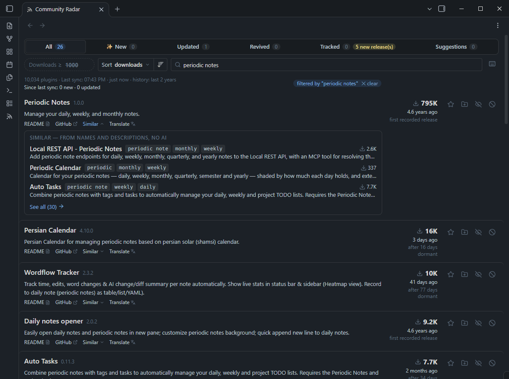

# Community Radar

Discover new and updated Obsidian community plugins, find the ones that came back after a long pause, and track the ones you care about as notes.

*[Türkçe](README.tr.md)*

With ~50 new community plugins a day, the built-in browser is hard to keep up with. Community Radar adds a discovery view inside Obsidian with six tabs:

| Tab | Shows |
|---|---|
| **All** | Every community plugin |
| **✨ New** | Plugins added in the last *N* days |
| **Updated** | Plugins released in the last *N* days |
| **Revived** | Plugins released in the last *N* days **after being dormant** (e.g. no release for 90+ days before). Constantly updated plugins are filtered out. |
| **Tracked** | Plugins you track, in sections per group (a plugin in two groups shows in both); one Group menu for All, New releases, Starred, Ungrouped and your groups |
| **Suggestions** | Installed plugins you haven't starred yet |


Clicking a plugin's name opens its page in Obsidian's own plugin browser, where you install it — Community Radar is for discovering and tracking, not installing. **README** on a row opens the plugin's README inside Obsidian, in its tracking note.

Plugins you **star** or **add to a group** become small notes in your vault, with the plugin's README inside. Use [Bases](https://help.obsidian.md/bases) to browse and edit them as a table. Plugins you **ignore** never show up again; **hide until the next release** brings a plugin back by itself when it ships one. Both lists open from the view's ⋮ menu, with search and *Restore*.


## Features

- **Filters on every tab**: *Downloads ≥* is a chip you switch on and off per tab, day ranges can be typed (e.g. last 1 day) or picked, and rows sort by downloads, last update, A–Z or recently added, in either direction.
- **Search** with comma-separated terms (all must match) or a `/regular expression/`, as in Obsidian's own search — e.g. `/project.+task/`.
- **Revived detection** from the official release archive — exact, no guessing (see [How it works](#how-it-works)).
- **Scheduled sync** every 6 hours, daily, weekly or manually. The view shows when the last sync ran and what it brought (*Since last sync: 5 new · 23 updated*).
- **Groups**: a plugin can be in several groups (a `groups` list). The group window stars the closest of your groups and adds AI suggestions you switch on and off; **Suggest groups for this list** (⋮ menu) puts AI suggestions under every row of the list you're looking at — up to 50, one request — in English and your language (*AI* next to *Yapay Zekâ*); pick on the rows and nothing is saved until **Accept**.
- **Similar plugins**, found locally — no AI, no request. *Similar* on a row shows the best 3 matches and the terms they share; *See all* opens the full list, best match first, with a match bar and every row action. *Similar* on a result goes one step further and the trail (`Periodic Notes › Periodic Calendar`) takes you back. Matching uses BM25 on names and descriptions (rare terms count most, names count double, word pairs like *daily note* count too) and spreads near-copies out.

  

  

- **Rating**: hover the ☆ on a row to give 1–5 stars (`rating`). The Tracked tab sorts by rating, so your favourites lead every group.
- **New releases** of tracked plugins: a yellow count on the Tracked tab, a *NEW RELEASE* signal on the row and a *New releases* entry in its Group menu, with *Mark all reviewed*.
- **Status** (optional, off by default): your own list of statuses, emoji included — e.g. 🔖 To try, 👀 Watching, 🧪 Testing, ✅ Adopted, 🔁 Replaced — edited in settings and stored as `status`.
- Rows are easy to scan: system signals next to the name, your note (groups, status, rating) on its own line, and a metrics column with downloads first. A row that an action moves out of the current filter stays (faded) until you reopen the view.
- **Sort by dormant period** to see which revived plugins were quiet the longest.
- **Keyboard** (off by default; *Settings → Keyboard shortcuts*): while the tab is active, `j`/`k` move the highlight and `f` star, `g` groups, `x` ignore, `h` hide until next release, `t` translate, `r` README, `s` similar, `o` open, `Enter` expand, `1`–`5` rate, `0` clear the rating. The ⌨ icon in the filter bar lists them.
- **Tracking notes**: `groups`, `favorite`, `note` and `reviewed` properties you can edit anywhere, plus `downloads`, `version` and `updated` kept up to date.
- **README in the note**, refreshed when a new version ships — when you open the note, on every sync, or only on demand. Your own notes in the note are never touched.
- **Translate descriptions** with your own API key — Claude, OpenAI, Gemini or OpenRouter. One request translates a whole page; translations are cached.

  

- **Signals** next to the name for NEW, NEW RELEASE and INSTALLED plugins; relative dates and dormant periods on every row.
- **English and Turkish** interface, following Obsidian's language or chosen in settings. [Add your language](#translating).
- Works on desktop and mobile.

## Installation

In Obsidian, open **Settings → Community plugins → Browse**, search for **Community Radar**, install and enable it.

**With BRAT** (pre-releases): install [BRAT](https://github.com/TfTHacker/obsidian42-brat), run *BRAT: Add a beta plugin*, enter `alitekdemir/obsidian-community-radar`.

**Manually:** download `main.js`, `manifest.json` and `styles.css` from the [latest release](https://github.com/alitekdemir/obsidian-community-radar/releases/latest) into `<your vault>/.obsidian/plugins/plugin-radar/` (the folder name is the plugin id), then enable **Community Radar** in *Settings → Community plugins*.

## Getting started

1. Run **Community Radar: Open Community Radar** (or click the radar icon in the ribbon). The catalog downloads on first open.
2. Click **Build release history** once. It downloads about a year of daily snapshots (~50 MB, a few minutes) and is needed for the *Revived* and *New* tabs. Later syncs only fetch the days you missed.
3. Star (☆), group (＋) or ignore (⊘) plugins from any row.
4. Optional: *Settings → Community Radar → Bases view → Create* adds a ready-made [Bases](https://help.obsidian.md/bases) table of your tracked plugins next to the notes folder (e.g. `Community Radar.base`). If you break it, **Reset** rewrites it from the template.

## Settings


| Setting | Options |
|---|---|
| Language | Auto (Obsidian's language), English, Türkçe |
| Notes folder | Where tracking notes are created |
| Suggest groups | Opens the Tracked tab's *Ungrouped* list in grouping mode |
| Keyboard shortcuts | Off by default |
| Status field | Off by default; add, rename (emoji welcome), reorder or remove statuses |
| Lists | *Manage* opens the ignored plugins or hidden suggestions in the view |
| Bases view | **Create** or **Reset** the Bases table of your tracking notes |
| Sync frequency | Manual · Every 6 hours · **Daily** · Weekly. Between syncs nothing is downloaded. **Sync now** runs one immediately. |
| README updates | **When I open the note** · On every sync · Manually (command palette) |
| History depth | 3, 6, 12 or 24 months |
| AI | Provider, API key (from Obsidian's keychain), model, target language — used for translations and group suggestions |

## Tracking notes

```yaml
---
plugin_id: homepage
groups:
  - startup
  - navigation
favorite: true
status: adopted           # optional; one of your statuses (Settings → Status field)
rating: 4                 # 1–5
note: try with the daily note
reviewed: 2026-10-31      # a release after this date marks the plugin NEW RELEASE
downloads: 1416257
version: 4.6.0
updated: 2026-10-25
obsidian: "[plugin](obsidian://show-plugin?id=homepage)"
github: "[github](https://github.com/mirnovov/obsidian-homepage)"
---
```

The body has a **My notes** section for you and a **README** section that the plugin owns, between two hidden `%% community-radar:readme-start/end %%` comments. README tags (`#tag`) and wiki links are escaped so they don't leak into your vault; code blocks are left as they are.


## How it works

Obsidian's [`obsidian-releases`](https://github.com/obsidianmd/obsidian-releases) repository commits `community-plugin-stats.json` **every day**. Each snapshot holds every plugin's latest release time. Community Radar reads these snapshots (daily for the last 30 days, weekly before that), keeps up to 50 release dates per plugin, and compares the current release with the previous one. That's how "released 7 days ago, after 52 days dormant" is exact even for plugins quiet for years. The same snapshots tell when a plugin first appeared, which powers the *New* tab.

## Network use

Community Radar only makes these requests:

| Destination | When | What |
|---|---|---|
| `raw.githubusercontent.com` | Sync, history build, README updates | The public plugin list, stats snapshots and plugin READMEs |
| `api.github.com` | History build and sync (1–4 requests); README fallback | The list of stats snapshots. Unauthenticated, 60 requests/hour |
| Your AI provider (`api.anthropic.com`, `api.openai.com`, `generativelanguage.googleapis.com` or `openrouter.ai`) | **Only** when you translate or ask for group suggestions, with a provider configured | Plugin names and descriptions, and the names of your groups |

No telemetry, no account, nothing about your vault is sent anywhere. Inside the vault, the plugin only reads and writes notes in its own notes folder; it never lists the rest of your files. API keys are stored in Obsidian's keychain (SecretStorage) on each device, never in `data.json`; the plugin stores only the key's name (e.g. `anthropic-api-key`), so other plugins using the same name share it. The installed-plugins list comes from Obsidian's internal `app.plugins` and is read defensively.

## Data

| Data | Where |
|---|---|
| Your groups, stars, notes, review dates | Your tracking notes |
| Ignored plugins, translations, settings | `.obsidian/plugins/plugin-radar/data.json` |
| Catalog and release history (rebuildable caches) | `.obsidian/plugins/plugin-radar/cache/` |

## Commands

- Open Community Radar
- Sync now (catalog, history, notes)
- Rebuild release history
- Update README of this note / of all tracking notes
- Create or reset the Bases view
- Suggest groups for ungrouped plugins

The view's ⋮ menu has: Sync now, Translate visible, Suggest groups for this list, Ignored plugins, Hidden suggestions, Rebuild history and Settings.

## Translating

All interface text lives in [`locales/`](locales), one JSON file per language. To add yours:

1. Copy `locales/en.json` to `locales/<code>.json` — the code Obsidian uses for your language, e.g. `de`, `fr`, `pt-BR`.
2. Set `language.name` (your language's own name, e.g. `Deutsch`) and `locale` (for number and date formats, e.g. `de-DE`), then translate the values. Keep `{placeholders}` exactly as they are.
3. Plural text is an object picked by the number `{n}`: `{"one": "{n} day ago", "other": "{n} days ago"}`. Use your language's [plural forms](https://www.unicode.org/cldr/charts/latest/supplemental/language_plural_rules.html) (`one`, `few`, `many`, `other`…); `other` is required. A language without plural forms can use a plain string.
4. Run `npm install && npm test` — it checks that your file has every key and placeholder — and open a pull request.

Missing text falls back to English, so a partly translated file still works. The new language appears in *Settings → Language* automatically.

## Development

`src/main.js` is the plugin; `npm run build` embeds `locales/*.json` into the `main.js` Obsidian loads (Obsidian installs only `main.js`, `manifest.json` and `styles.css`). There are no dependencies at runtime. Tests run offline in Node with a small fake of the Obsidian API:

```sh
npm install
npm test        # builds main.js first
```

To try changes in a vault, run `npm run build` and copy `main.js`, `manifest.json` and `styles.css` into `<vault>/.obsidian/plugins/plugin-radar/`.

To release, bump the version in `manifest.json`, `package.json` and `versions.json`, update `CHANGELOG.md`, then publish a GitHub release whose tag is that version (e.g. `0.6.0`, no `v`). Don't attach files: the release workflow tests, builds and attests `main.js`, `manifest.json` and `styles.css` and attaches them.

## License

[MIT](LICENSE) © Ali Tekdemir
