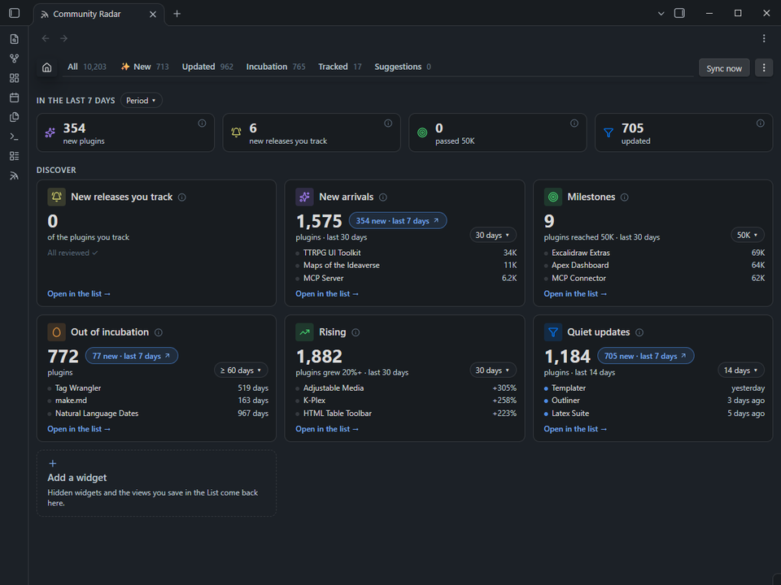
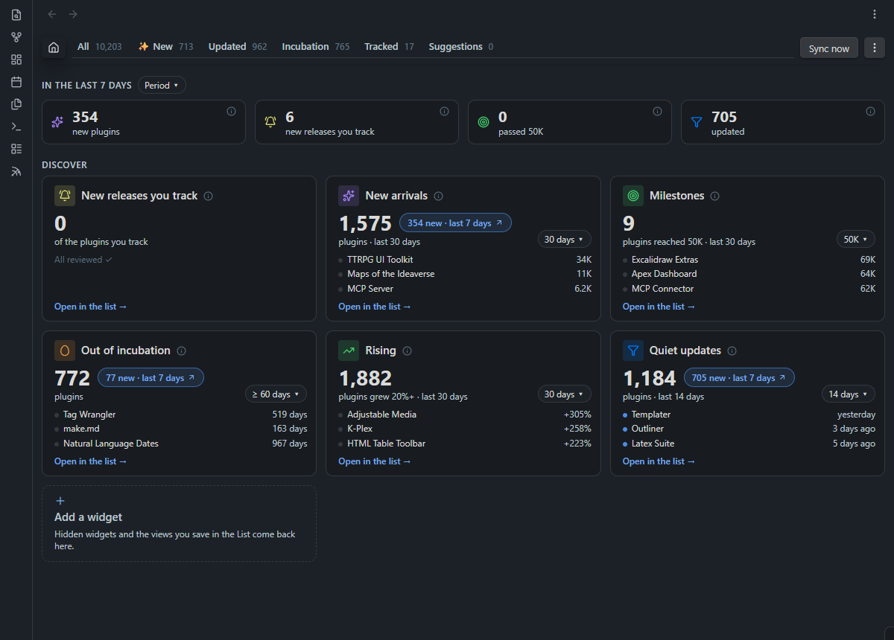
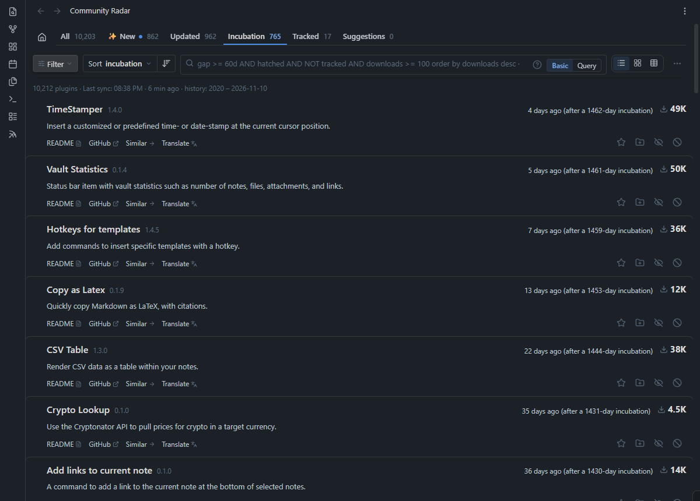
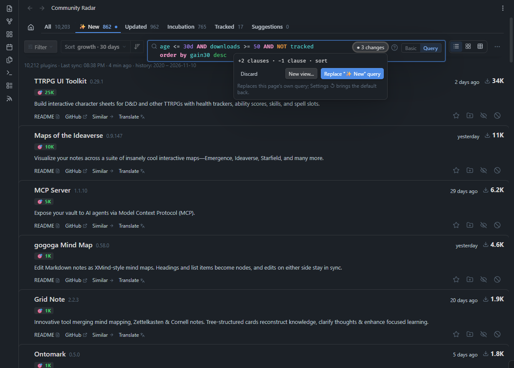
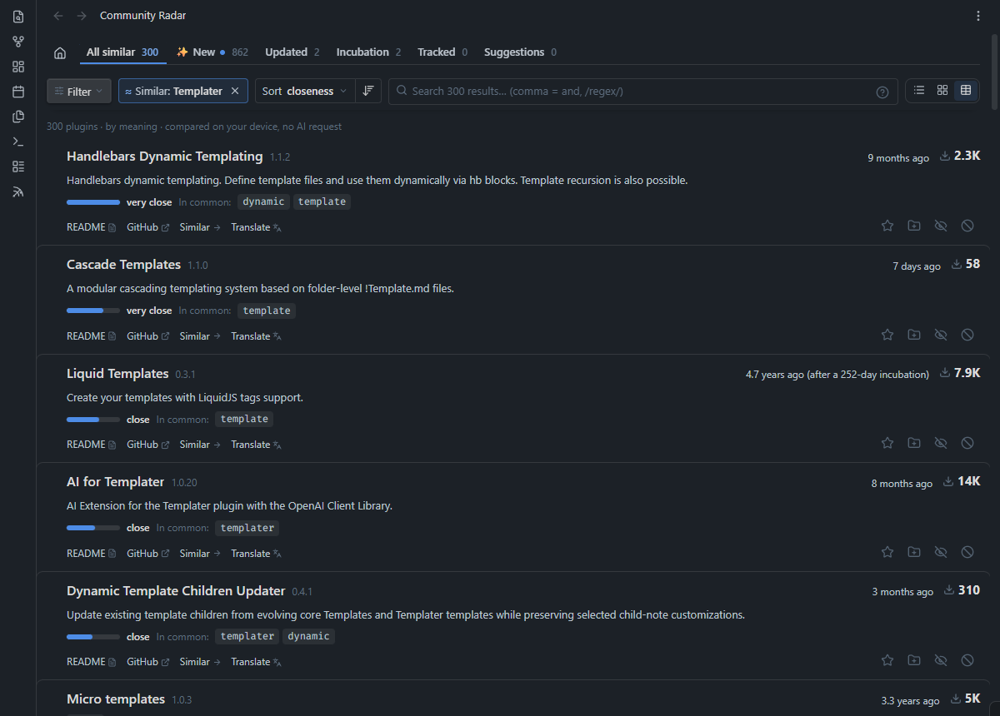
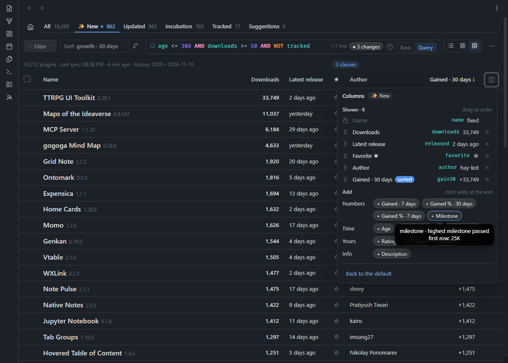
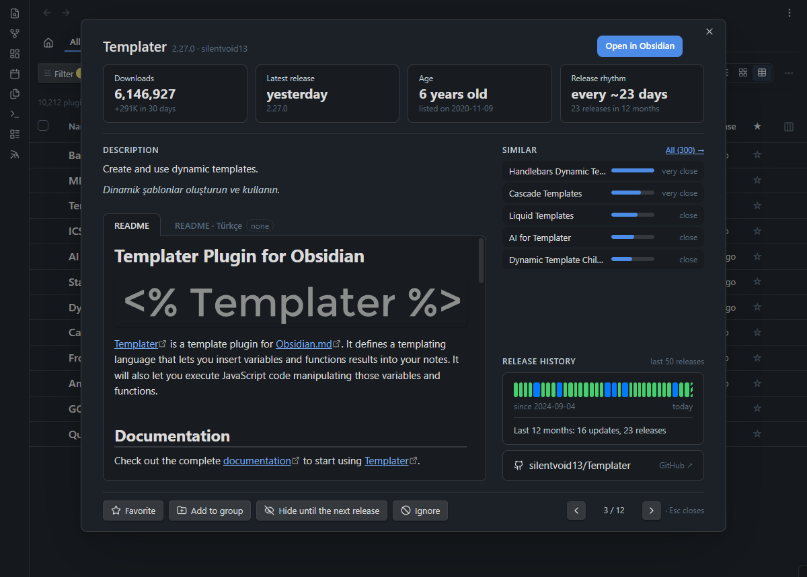
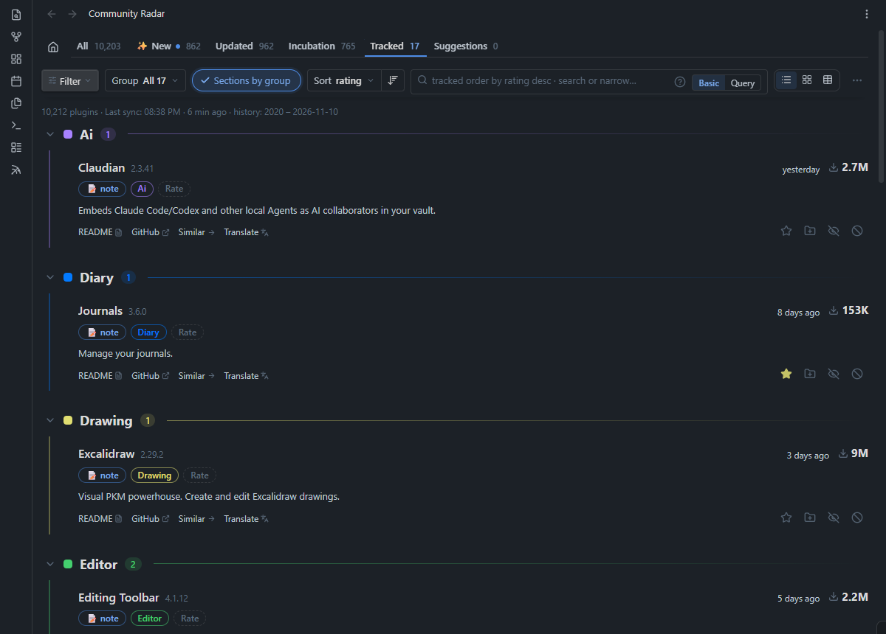

# Community Radar

**Obsidian'ın 10.000'den fazla topluluk eklentisi için radarınız.** Neyin yeni olduğunu, neyin yükseldiğini ve yıllar sonra neyin uyandığını görün. Listeye Jira'daki gibi sorular sorun, aynı işi yapan eklentileri anlamına göre bulun, ilgilendiklerinizi vault'unuzda not olarak tutun.

*[English](README.md)*



## Neden

- **Takip edilemeyecek kadar çok şey oluyor.** Her gün yaklaşık 50 yeni eklenti geliyor, yüzlercesi güncelleniyor. Obsidian'ın tarayıcısı hepsini aynı şekilde gösteriyor. Community Radar, son bakışınızdan beri neyin değiştiğiyle açılıyor.
- **Büyüme ve sessizlik görünmüyor.** Obsidian yalnız bugünkü indirme sayısını gösteriyor. Community Radar 2020'den bu yana her günün kaydını yeniden oynatıyor: bu ay en çok kim kazandı, kim 10K'yı geçti, kim bir yıl sonra yeniden sürüm çıkardı.
- **Bulduklarınız kayboluyor.** Geçen ay beğendiğiniz bir eklenti, adını hatırlamadığınız bir şeye dönüşüyor. Burada gruplarınız, puanınız ve notlarınızla bir not oluyor; README'si de hep güncel kalıyor.

## Neler yapar

### 🏠 Neyin değiştiğini gösteren bir ana sayfa



Üstteki şerit henüz görmediklerinizi sayar: yeni eklentiler, takip ettiklerinizin yeni sürümleri, geçilen barajlar ve gürültüsüz güncellemeler. Listeyi açınca sıfırlanır; Obsidian'ı yeniden başlatmak sıfırlamaz. Altındaki kartların her biri bir soruyu yanıtlar: *Yeni gelenler*, *Baraj geçenler*, *Kuluçkadan çıkanlar*, *Yükselenler*, *Gürültüsüz güncellemeler*, *Takipte yeni sürüm*, *Kurulu ama takip edilmeyen*. Kartın süresini ya da eşiğini doğrudan kartın üstünde değiştirin; **N yeni** rozeti yalnız yenileri açar.

### 🥚 Geri dönen eklentiler



*Kuluçka* en az 60 günlük sessizlikten sonra yeniden sürüm çıkaran eklentileri listeler, örneğin "4 gün önce (1.462 günlük kuluçkadan sonra)". *Güncellenen* birkaç günde bir sürüm çıkaranları dışarıda bırakır, böylece gerçek bir güncelleme kalabalıkta kaybolmaz. İkisi de yalnız son sürüme değil, sürüm geçmişinin tamamına bakar.

### 🔍 Bir sorgu dili ve isteyenler için Basit mod



Her sekme okuyup değiştirebileceğiniz bir sorgudur:

```
age <= 30d AND downloads >= 50 AND NOT tracked
order by gain30 desc
```

27 alan, `startOfMonth()` ve `lastSync()` gibi tarih işlevleri, yazarken öneriler (`Ctrl+Space`), renkler ve üstüne geldiğiniz her kelimenin açıklaması. Kısa başvuru için `?`'e basın. Hiçbir şey eşleşmezse listeyi hangi koşulun boşalttığını söyler. Tıklamayı mı seviyorsunuz? **Basit** mod aynı filtreleri bir **Filtre** düğmesinin arkasında sunar. Değiştirdiğiniz bir sorgu sekmenin kendi sorgusunun yerine geçebilir ya da **görünüm** olarak kaydedilebilir: yeni eşleşmeleri sayan kendi sekmesi ve ana sayfada bir kartı olur. Ayrıntılar için [sorgu başvurusu](docs/query.md) (İngilizce).

### ≈ Anlamca benzerler



Herhangi bir eklentideki **Benzerleri →**, yakın işler yapan 300'e kadar eklentiyi en yakından başlayarak listeler; ortak bir kelime olmasa bile. Her eklentinin açıklamasından her gün üretilen vektörlerle cihazınızda çalışır. API anahtarı gerekmez.

### 📊 Liste, kart ya da tablo; birçok eklenti birden



**Liste**, **Kart** ve **Tablo** arasında geçin. Tabloda seçebileceğiniz 16 sütun var: indirme, 7 ya da 30 günde kazanılan, yüzde artış, baraj, sürüm ritmi gibi. Her sayfa kendi sütunlarını hatırlar. Satırları işaretleyip (ya da **Listedeki N eklentinin hepsini seç**) toplu olarak favorileyin, puanlayın, gruplayın, gizleyin ya da dışlayın. **Son işlemler** son 20 toplu değişikliğinizi tutar; **Geri al** o arada elle değiştirdiklerinizi atlar. Detay penceresi için satıra tıklayın: istatistikler, README, sürüm geçmişi ve benzerler.



### 📝 Size ait notlar ve isteğe bağlı yapay zekâ



Bir eklentiyi yıldızlayın ya da bir gruba ekleyin, vault'unuzda bir notu olsun: gruplar, favori, puan, durum ve notlarınız özelliklerde; README'si altında, hep güncel. Tek tıkla hepsinin **Obsidian Bases** tablosu oluşur. Bir API anahtarıyla (Anthropic, OpenAI, Google ya da OpenRouter) açıklamaları ve README'leri kendi dilinize çevirebilir, seçtiğiniz satırlar için grup önerisi alabilirsiniz. Siz kurana kadar yapay zekâ kapalıdır. Ayrıntılar için [takip notları](docs/tracking-notes.md) (İngilizce).

## Kurulum

**Ayarlar → Topluluk eklentileri → Göz at**'ı açın, **Community Radar**'ı arayın, **Yükle** ve **Etkinleştir**'e basın. Kenar çubuğundaki simgeyle ya da **Community Radar'ı aç** komutuyla açın.

## 60 saniyede başlangıç

1. İlk eşitleme eklenti listesini ve sürüm geçmişini indirir (yaklaşık 3 MB).
2. **Ana sayfa**'ya bakın: son ziyaretinizden beri neler yeni.
3. Bir kartın listesini açın. Beğendiğiniz bir eklentiyi yıldızlayın; vault'unuzda notu oluşur.
4. Herhangi bir sekmede **Sorgu**'ya basın: kuralını görün, değiştirin, kendi görünümünüz olarak kaydedin.

## Gizlilik

Hesap yok, telemetri yok. Community Radar yalnız kendi not klasörünü okur. GitHub'dan herkese açık dosyaları indirir; bir yapay zekâ sağlayıcısını yalnız çeviri ya da grup önerisi istediğinizde çağırır. API anahtarları Obsidian'ın anahtar zincirinde kalır. [Bütün istekler, tek tek.](docs/how-it-works.md#network) (İngilizce)

## Belgeler (İngilizce)

- [Sorgu dili](docs/query.md): alanlar, işlemler, tarihler, örnekler
- [Takip notları](docs/tracking-notes.md): notun özellikleri ve Bases görünümü
- [Ayarlar ve komutlar](docs/settings-commands.md): her ayar, komut ve kısayol
- [Nasıl çalışır](docs/how-it-works.md): verinin kaynağı, ağ, depolama
- [Geliştirme ve çeviri](docs/development.md)
- [Değişiklik günlüğü](CHANGELOG.md)

## Lisans

[MIT](LICENSE) © Ali Tekdemir · [Sponsor ol](https://github.com/sponsors/alitekdemir)
