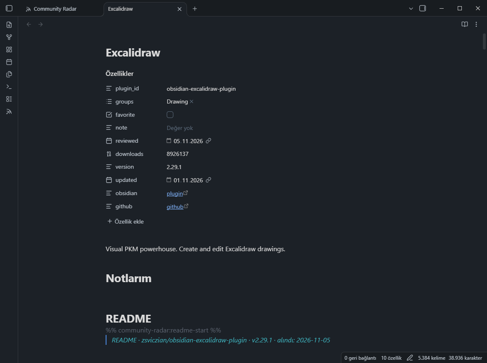
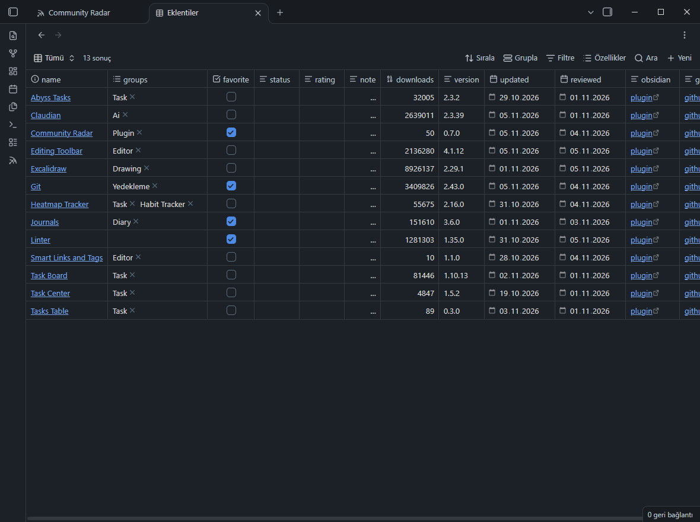

# Tracking notes

Star a plugin, rate it, give it a status or add it to a group, and Community Radar writes a note for it in your notes folder (*Settings → Notes folder*). The note is yours: edit its properties in Obsidian, and the list follows.

## Properties

```yaml
---
plugin_id: homepage
groups:
  - startup
  - navigation
favorite: true
status: adopted           # optional; one of your statuses (Settings → Status field)
rating: 4                 # 1–5
note: try with the daily note
reviewed: 2026-10-31      # a release after this date marks the plugin NEW RELEASE
description: Open a note, base or workspace on startup, or set it for quick access later.
downloads: 1416257
version: 4.6.0
updated: 2026-10-25
obsidian: "[plugin](obsidian://show-plugin?id=homepage)"
github: "[github](https://github.com/mirnovov/obsidian-homepage)"
---
```

| Property | Who writes it |
|---|---|
| `plugin_id`, `description`, `downloads`, `version`, `updated`, `obsidian`, `github` | Community Radar, on each sync |
| `groups`, `favorite`, `status`, `rating`, `note`, `reviewed` | You (from the list, or by editing the note) |

A plugin can be in several groups (`groups` is a list). `reviewed` is set when you mark a new release reviewed; a later release shows the plugin as **NEW RELEASE** in *Tracked*.

## Body

- **My notes** (the heading is set in *Settings → Heading of your notes*): yours, never touched.
- **README (your language)**: when you ask for a translation.
- **README**: owned by the plugin, between two hidden `%% community-radar:readme-start/end %%` comments. It's refreshed when you open the note (or on every sync, or only by command: *Settings → README updates*). Tags and wiki links in it are escaped so they don't leak into your vault; code blocks stay as they are.



## Bases view

*Settings → Reset Bases view → Create* (or the command *Create or reset the Bases view*) writes a `.base` file that lists all your tracking notes as a table you can sort, filter and edit in place.



## AI, optional

With a provider and key in *Settings → AI*, Community Radar can:

- **Translate** a description (the **Translate** link on a row, or *Translate visible* in the view's ⋮ menu) or a README (in the details window, or the command *Translate the README of this note*). A README translation shows its estimated cost first. Translations are saved and reused.
- **Suggest groups** for the rows you select (the **Suggest groups** button in the selection bar), or for ungrouped tracked plugins (command). Click a suggestion to add it.

You can rewrite the instructions sent to the model in *Settings → AI*.
