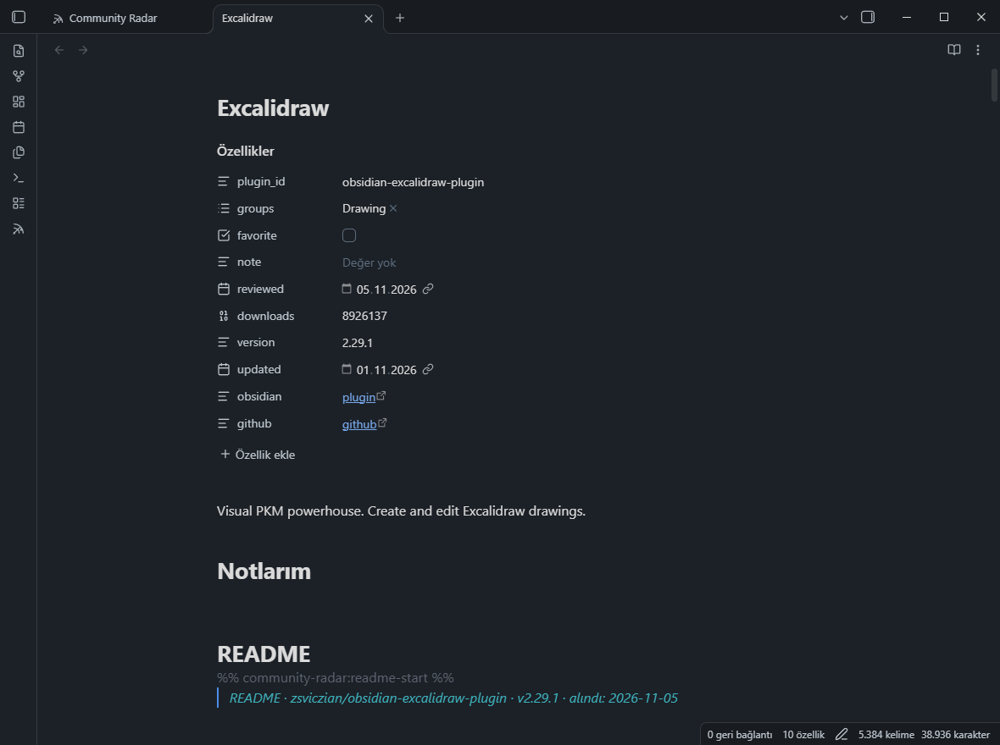
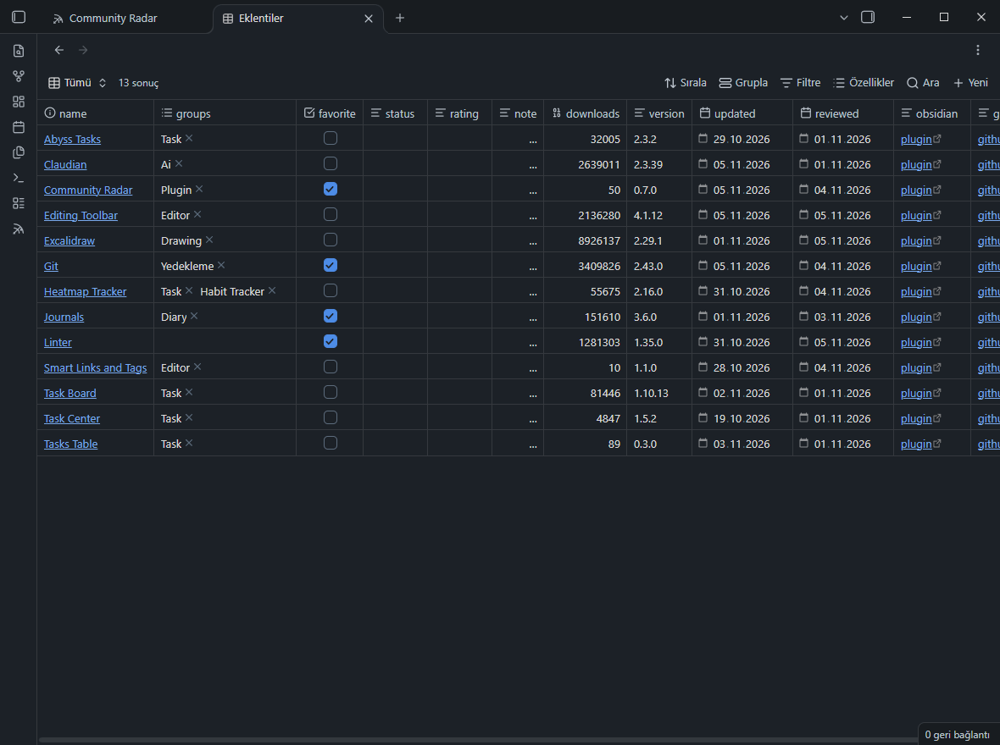

# Takip notları

*[English](tracking-notes.md) · Türkçe*

Bir eklentiyi takip edin (🔔), puanlayın (★), durum atayın ya da bir gruba ekleyin; Community Radar not klasörünüzde (*Ayarlar → Not klasörü*) onun için bir not yazar. Not sizindir: özelliklerini Obsidian'da düzenleyin, liste de ona uyar. 🔔'ye yeniden tıklarsanız (ya da ⋯ → *Takibi bırak*) not Obsidian'ın çöp kutusuna gider, oradan geri getirebilirsiniz; notta gruplarınız, puanınız, durumunuz ya da notlarınız varsa önce sorulur. 4★ ve üzeri verdiğiniz eklentiler *Takip → ★ 4+* altında toplanır.

## Özellikler

```yaml
---
plugin_id: homepage
groups:
  - startup
  - navigation
status: adopted           # isteğe bağlı; durumlarınızdan biri (Ayarlar → Durum alanı)
rating: 4                 # 1–5
note: try with the daily note
reviewed: 2026-10-31      # bu tarihten sonraki bir sürüm eklentiyi YENİ SÜRÜM olarak işaretler
description: Open a note, base or workspace on startup, or set it for quick access later.
downloads: 1416257
version: 4.6.0
updated: 2026-10-25
obsidian: "[plugin](obsidian://show-plugin?id=homepage)"
github: "[github](https://github.com/mirnovov/obsidian-homepage)"
---
```

| Özellik | Kim yazar |
|---|---|
| `plugin_id`, `description`, `downloads`, `version`, `updated`, `obsidian`, `github` | Community Radar, her eşitlemede |
| `groups`, `status`, `rating`, `note`, `reviewed` | Siz (listeden ya da notu düzenleyerek) |
| `translation_model`, `translation_tokens`, `translation_cost` | Community Radar, README'yi çevirdiğinde: yapay zekâ sağlayıcısının bildirdiği model, token ve maliyet (USD); maliyet yalnızca sağlayıcı bildirdiğinde yazılır (ör. OpenRouter) |

Bir eklenti birden fazla grupta olabilir (`groups` bir listedir). `reviewed`, yeni bir sürümü incelendi olarak işaretlediğinizde yazılır; daha sonraki bir sürüm eklentiyi *Takip*'te **YENİ SÜRÜM** olarak gösterir.

## Gövde

- **Notlarım** (başlığı *Ayarlar → Notlarınızın başlığı*'ndan ayarlanır): sizindir, hiç dokunulmaz.
- **README (sizin dilinizde)**: çeviri istediğinizde eklenir. Çevrildiği README'nin gizli parmak izi, metnin o zamandan beri değişip değişmediğini Community Radar'a bildirir.
- **README**: eklentiye aittir, iki gizli `%% community-radar:readme-start/end %%` yorumu arasında durur. Notu açtığınızda yenilenir (ya da her eşitlemede, ya da yalnızca komutla: *Ayarlar → README güncelleme*). İçindeki etiketler ve wiki bağlantıları kasanıza sızmaması için kaçış karakteriyle korunur; kod blokları olduğu gibi kalır.



## Bases görünümü

*Ayarlar → Bases görünümünü sıfırla → Oluştur* (ya da *Bases görünümünü oluştur ya da sıfırla* komutu) tüm takip notlarınızı yerinde sıralayıp filtreleyip düzenleyebileceğiniz bir tablo olarak listeleyen bir `.base` dosyası yazar.



## Yapay zekâ, isteğe bağlı

*Ayarlar → Yapay zekâ*'da bir sağlayıcı ve anahtar varsa Community Radar şunları yapabilir:

- Bir açıklamayı (satırda, kartta ya da ayrıntılar penceresinde üzerine tıklayarak ya da görünümün ⋮ menüsündeki *Görünenleri çevir* ile) ya da bir README'yi (ayrıntılar penceresinde ya da *Bu notun README'sini çevir* komutuyla) **çevirmek**. README çevirisi önce tahmini maliyetini gösterir; gerçek maliyeti ayrıntılar penceresinin alt satırında görünür. Çeviriler kaydedilir ve yeniden kullanılır: README çevirisi takip edilen eklentilerde notuna, takip etmediklerinizde ise önbelleğe yazılır; eklentiyi sonradan takip ederseniz yeni nota taşınır ve ikinci kez ücret ödemezsiniz. Çeviri sekmesindeki sarı nokta, README'nin o çeviriden sonra değiştiği anlamına gelir.
- Seçtiğiniz satırlar için (seçim çubuğundaki **AI ile grupla** düğmesi) ya da grubu olmayan takip edilen eklentiler için (komut) **grup önermek**. Bir öneriye tıklamak onu ekler.

Modele gönderilen talimatları *Ayarlar → Yapay zekâ*'da yeniden yazabilirsiniz.
